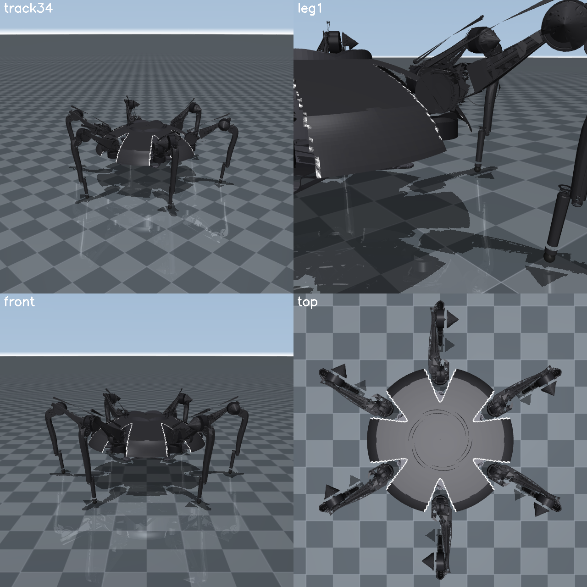

# TOCATL Hexapod — Sim, Software & CAD

Workspace for **TOCATL**, the RoMeLa six-legged spider robot (18 CyberGear
motors, 3 per leg). This repo collects the ROS 2 software, a MuJoCo walking
simulator that uses the real CAD for its visuals, and the SolidWorks CAD.



A demo of the simulated walk is in [`walk.mp4`](walk.mp4).

## Layout

| Path | Contents |
|---|---|
| [`romela-tocatl/`](romela-tocatl/) | ROS 2 Jazzy workspace (see its [README](romela-tocatl/README.md)) |
| `romela-tocatl/src/tocatl_sim/` | MuJoCo simulator: physics, gait, keyboard teleop, video recorder ([README](romela-tocatl/src/tocatl_sim/README.md)) |
| `romela-tocatl/src/tocatl_{kinematics,gait,control,diagnostics,bringup}/` | Kinematics, gait, control, motor-map and bringup packages |
| `romela-tocatl/legacy/` | The recovered March 2026 robot code, kept for reference only (do **not** run it on hardware) |
| `romela-tocatl/docs/` | Motor map, Pi/CAN inventory, safety and controller notes |
| [`TOCATL_CAD/`](TOCATL_CAD/) | SolidWorks parts/assemblies (Production v1.4) |
| `TOCATL_CAD/converted_stl/`, `conversion_scripts/` | STL exports of the parts and the scripts used to make them |
| `TOCATL_MuJoCo_Sim_Prompt.md` | Spec the simulator was built against |
| `romela_spider_*.md` | Dated work notes |

## Quick start (simulation)

Requires Ubuntu 24.04 + ROS 2 Jazzy.

```bash
git lfs install                      # CAD, STL and video files are stored in Git LFS
git clone https://github.com/birds0416/romela_tocatl.git
cd romela_tocatl/romela-tocatl

source /opt/ros/jazzy/setup.bash
pip install mujoco numpy opencv-python pynput
colcon build --packages-select tocatl_kinematics tocatl_gait tocatl_diagnostics tocatl_sim
source install/setup.bash

ros2 launch tocatl_sim sim.launch.py   # viewer + gait + keyboard teleop
```

If you use conda, deactivate it first (or `export PATH=/usr/bin:$PATH`).
Otherwise conda's `python3` hides the system one that has `rclpy`.

Keys: `W/S` forward/back, `A/D` strafe, `Q/E` turn, `R/F` body up/down,
`1/2/3` tripod/ripple/wave gait, `Space` stop. The full key table is in the
[sim README](romela-tocatl/src/tocatl_sim/README.md).

Run the tests with `python3 -m pytest src/tocatl_sim/test/test_walk.py`.
Re-record the video with `MUJOCO_GL=egl ros2 run tocatl_sim record_walk`.

## Hardware safety

The simulator never touches CAN or the motors. Before running anything on the
real robot, read [`romela-tocatl/README.md`](romela-tocatl/README.md) and
`romela-tocatl/docs/`. The legacy scripts enable the motors and rewrite zero
positions at startup.
